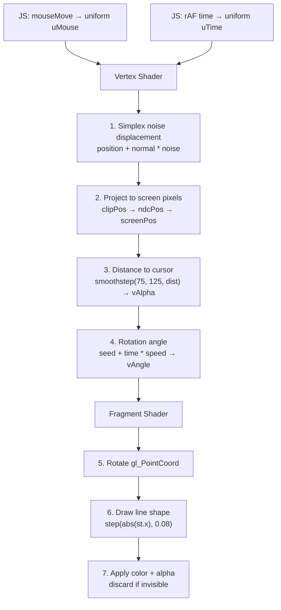

# Three.js Dynamic Particle Background Overhaul

Replace the current 2D canvas-based `InteractiveBackground` with a GPU-accelerated Three.js particle system rendered on a warped sphere surface, where particles (tiny rotating lines) are only visible within 75–125px of the cursor.

## Reference

The visual target is inspired by [antigravity.google](https://antigravity.google/) — colorful confetti-like fragments scattered across a sphere surface, with cursor-reactive visibility and organic drift.


## User Review Required

> [!IMPORTANT]
> **Color palette**: Using the custom palette: `#003049` (deep navy), `#d62828` (crimson), `#f77f00` (amber), `#fcbf49` (gold), `#eae2b7` (warm cream), plus close shades for variety.

> [!IMPORTANT]
> **Particle count**: I'm targeting ~10,000–15,000 particles on the sphere. This is enough for visual density near the cursor while staying lightweight. Higher counts (30k+) are possible with the shader approach but would increase GPU load on mobile. Is this acceptable?

> [!IMPORTANT]
> **Sphere visibility**: The warped sphere slowly rotates in the background but is entirely invisible — particles only reveal themselves when the cursor is nearby (75–125px). When you move the cursor across the screen, you "discover" the surface. Is this the interaction model you want, or should there be a faint base visibility?

## Open Questions

1. **Dark mode treatment**: In dark mode, should the particles be brighter/more vibrant with a subtle glow? Or keep the same opacity behavior as light mode?
2. **Mobile / touch**: On mobile devices there's no hover cursor. Should we show a static subset of particles, respond to touch, or hide the effect entirely on mobile?

## Proposed Changes

### Architecture Decision: Vanilla Three.js + Custom GLSL Shaders

Based on research, I'm choosing **vanilla Three.js** over `@react-three/fiber` because:
- **~50–115KB smaller** gzipped bundle (no R3F reconciler overhead)
- This is a single self-contained background canvas, not a complex 3D scene
- Direct `useEffect` lifecycle gives precise disposal control

For rendering, I'm using **`THREE.Points` + custom `ShaderMaterial`** because:
- **1 vertex per particle** (vs 2–6 for InstancedMesh lines) — most GPU-efficient
- All logic (noise displacement, cursor distance, rotation, visibility) runs **entirely on the GPU** — zero per-frame CPU iteration
- The fragment shader draws oriented line shapes inside each point sprite

---

### Dependencies

#### [NEW] three.js dependency in [package.json](file:///home/agile/git-ai-repo/agileplaya.com/package.json)

- Add `three` (~150KB gzipped) as a dependency
- Add `@types/three` as a devDependency
- Use named imports for tree-shaking: `import { WebGLRenderer, Scene, ... } from 'three'`

---

### Particle Background Component

#### [NEW] [ParticleBackground.tsx](file:///home/agile/git-ai-repo/agileplaya.com/src/components/layout/ParticleBackground.tsx)

The core Three.js component with `'use client'` directive. Contains:

**Geometry**: `IcosahedronGeometry(radius, detail=64)` provides evenly distributed vertices on a sphere. Each vertex becomes a particle.

**Vertex Shader** (runs per-particle on GPU):
1. **Simplex noise displacement** — displaces each sphere vertex along its normal by `snoise(position * scale + time)`, creating the organic warped-sphere surface
2. **Screen-space cursor distance** — projects each displaced vertex to screen pixels, calculates `distance(screenPos, mousePos)`, outputs alpha via `smoothstep(75.0, 125.0, dist)`
3. **Per-particle rotation** — calculates `angle = seed + time * spinSpeed` from per-vertex attributes

**Fragment Shader** (runs per-pixel on GPU):
1. Rotates `gl_PointCoord` by the computed angle
2. Draws a thin rectangle (line shape) using `step()` functions
3. Applies Google brand color (passed as a per-vertex attribute)
4. Discards fragments outside the line shape or when alpha ≤ 0 (invisible particles)

**Uniforms** (updated each frame):
- `uTime` — animation clock
- `uMouse` — cursor position in screen pixels
- `uResolution` — viewport dimensions
- `uNoiseScale`, `uDisplacement` — warping controls
- `uIsDark` — theme-aware rendering

**Per-vertex attributes** (set once on init):
- `aRotationSeed` — random initial angle
- `aSpinSpeed` — random rotation speed
- `aColorIndex` — index into the Google color palette

**Performance features**:
- `renderer.setPixelRatio(Math.min(devicePixelRatio, 2))` — cap pixel ratio
- `depthWrite: false`, `transparent: true` — optimal blending
- Proper cleanup: `.dispose()` on geometry, material, renderer on unmount
- `requestAnimationFrame` with cleanup

#### [NEW] [ParticleBackgroundWrapper.tsx](file:///home/agile/git-ai-repo/agileplaya.com/src/components/layout/ParticleBackgroundWrapper.tsx)

Client component wrapper using `next/dynamic` with `{ ssr: false }` to prevent SSR errors from Three.js browser API usage. This is **required** by Next.js 16 — `ssr: false` must be in a `'use client'` file.

```tsx
'use client';
import dynamic from 'next/dynamic';

const ParticleBackground = dynamic(
  () => import('./ParticleBackground'),
  { ssr: false }
);

export default function ParticleBackgroundWrapper() {
  return <ParticleBackground />;
}
```

---

### Layout Integration

#### [MODIFY] [layout.tsx](file:///home/agile/git-ai-repo/agileplaya.com/src/app/layout.tsx)

- Replace `InteractiveBackground` import with `ParticleBackgroundWrapper`
- The new component occupies `position: fixed; inset: 0` behind all content (same z-index pattern)

#### [MODIFY] [page.tsx](file:///home/agile/git-ai-repo/agileplaya.com/src/app/page.tsx)

- Remove the ambient color blob divs (lines 32–33) — the Three.js background replaces this visual effect

---

### Cleanup

#### [DELETE] [InteractiveBackground.tsx](file:///home/agile/git-ai-repo/agileplaya.com/src/components/layout/InteractiveBackground.tsx)

The old 2D canvas particle system is fully replaced.

---

## Technical Detail: Shader Pipeline



## Verification Plan

### Automated Tests
- `npm run build` — ensure the production build compiles without errors (validates dynamic import, tree-shaking, TypeScript types)

### Manual Verification
- `npm run dev` — verify the particle background renders correctly
- Move cursor across the screen — particles should appear/disappear smoothly within the 75–125px radius
- Verify particles are tiny rotating/spinning colored lines on a curved, warped surface
- Toggle dark/light mode — verify theme-appropriate rendering
- Check browser DevTools Performance tab — should maintain 60fps with <15ms frame times
- Test on a smaller viewport / simulated mobile
